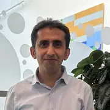

The group is based at **PhyLife – Physical Life Sciences**, Department of Physics, Chemistry and Pharmacy, University of Southern Denmark, Odense.

## Group leader

Himanshu Khandelia

Associate Professor

Computational biophysics, membranes and membrane proteins

## Research staff and postdocs

Ali Asghar Hakami Zanjani

Staff Scientist

Membrane repair

Luise Jacobsen

Postdoc

Proton-coupled transport

Hassan Ghermezcheshme

Postdoc

Nanoplastics and peptide-functionalized filtration

Sneha Menon

Postdoc

Transport through membrane proteins

Zhi Wei Zeng (Wilson)

Postdoc

SLC25 proteins

For authoritative SDU employment information, see [PhyLife employees](https://www.sdu.dk/en/forskning/phylife/employees).
